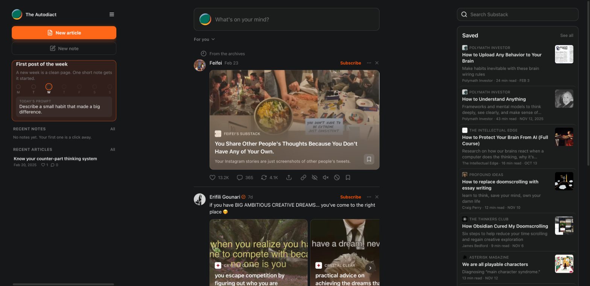
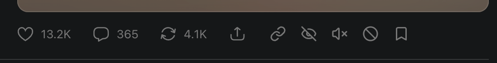
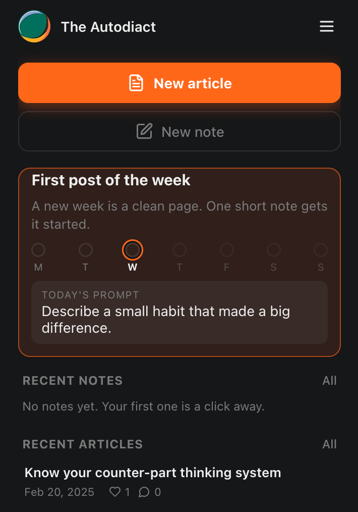
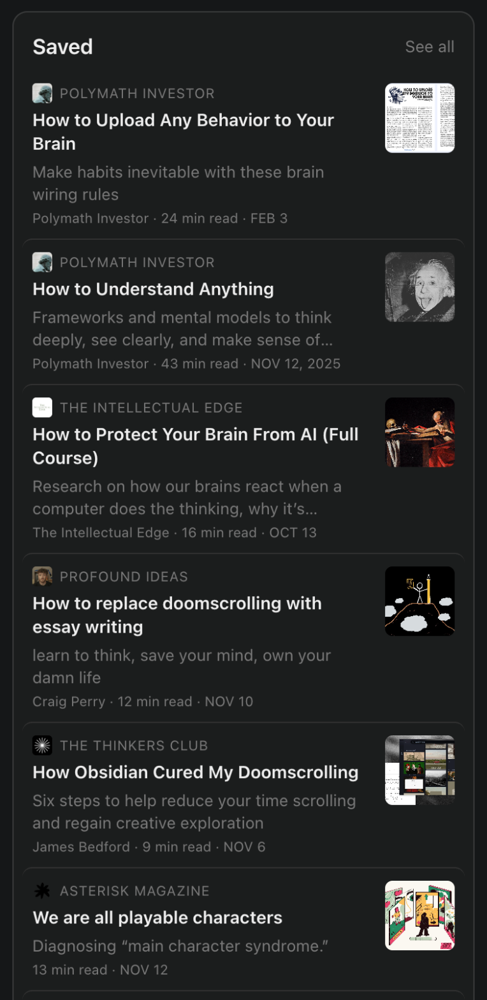

# Substack Quick Actions

A Chrome extension that turns [substack.com](https://substack.com) into a
writing-first place: one-click actions on every note, your Saved posts always in
view, and a left column that nudges you to post today.

## Features

### Quick actions on every note

Five buttons are added to each note's action bar, right after Like, Comment,
Restack and Share, so you no longer have to dig through the **…** menu:

| Button (left to right) | What it does |
| --- | --- |
| Copy link | Copies the note's link |
| Hide note | Hides the note from your feed |
| Mute | Mutes the author |
| Block | Blocks the author |
| Save | Saves the note, or the article it shares (hover the button to see which) |

Each button clicks the matching item in the note's own **…** menu, with the
menu kept out of sight. Everything behaves exactly as if you'd done it by hand,
including Substack's confirmation dialogs for Mute and Block. The buttons that
toggle also work in reverse (Unsave, Unmute, Unblock). The icon briefly shows a
✓ or ✗, and hovering it after a failure tells you why.

### Writer column

On screens 1280px and wider, Substack's left navigation is replaced by a column
built to get you writing:

- **New article** opens the post editor of your publication. **New note**
  opens Substack's own note composer.
- **A nudge** for the first post of the week, then the first post of the day,
  with your current streak and a Monday–Sunday tracker of the days you posted.
- **Today's prompt**: a short writing prompt that changes daily. Click it to
  start a note.
- **Your 3 most recent notes and articles**, with likes and replies.
- **☰** opens Substack's original navigation as a popover whenever you need it.

Your posting history comes from Substack's API and is kept locally, so your
streak isn't limited to the posts in the latest page of results. The column
refreshes every 5 minutes, when you come back to the tab, and a few seconds
after you close the note composer.

### Saved panel

On the home feed, the right sidebar's *Subscriptions* and *Recommended for you*
cards are replaced by the posts you've saved, newest first, with publication,
subtitle, author, reading time and cover image. **Load more** pages through the
rest. The panel refreshes after you save something and when you return to the
tab.

### Fewer distractions

- The *People to follow* modules are removed from the feed.
- The feed is re-centered between the writer column and the right sidebar.

## Install

The extension isn't in the Chrome Web Store, so you load it from this folder:

1. Download this repository: `git clone https://github.com/binhphuong-ab/SubstackQuickActions.git`
   (or **Code → Download ZIP** and unzip it).
2. Open `chrome://extensions` and switch on **Developer mode** (top right).
3. Click **Load unpacked** and select the `SubstackQuickActions` folder.
4. Open or reload [substack.com](https://substack.com). You need to be signed in.

**To update:** run `git pull` (or download again), click ↻ on the extension's
card in `chrome://extensions`, then reload your Substack tabs.

It works in Chrome and other Chromium browsers that support Manifest V3
extensions (Edge, Brave, Arc).

## Privacy

- **No servers of its own:** the extension talks only to substack.com's own
  API, using the session you're already signed in with.
- **One permission:** `storage`, used to keep your posting history (for the
  streak) on your own computer, in `chrome.storage.local`.
- **No tracking:** no analytics and no third-party scripts.
- **Substack only:** it runs on `https://substack.com/*` and nowhere else.

## Limitations

- It's built on Substack's page structure, which isn't a public API. If
  Substack redesigns a page, part of the extension may stop working until it's
  updated.
- It runs on substack.com itself. It does not run on publication subdomains
  (`name.substack.com`) or custom domains.
- The writer column needs a window at least 1280px wide. Below that, Substack's
  own navigation is left alone.
- The labels it matches (menu items, section headings) are in English.

## Project layout

| File | Purpose |
| --- | --- |
| `manifest.json` | Extension manifest (MV3) |
| `content.js` / `content.css` | Quick actions, Saved panel, hidden feed modules |
| `writer.js` / `writer.css` | Writer column, nudges and streak, feed centering |
| `docs/` | Screenshots used in this README |

There's no build step: edit the files, then click ↻ on the extension's card in
`chrome://extensions` and reload the Substack tab.
